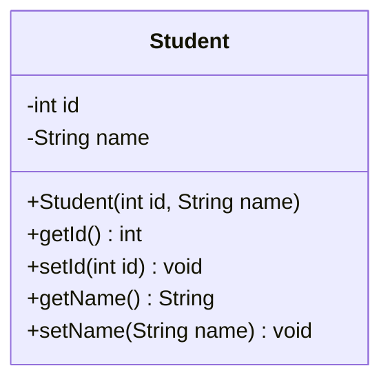
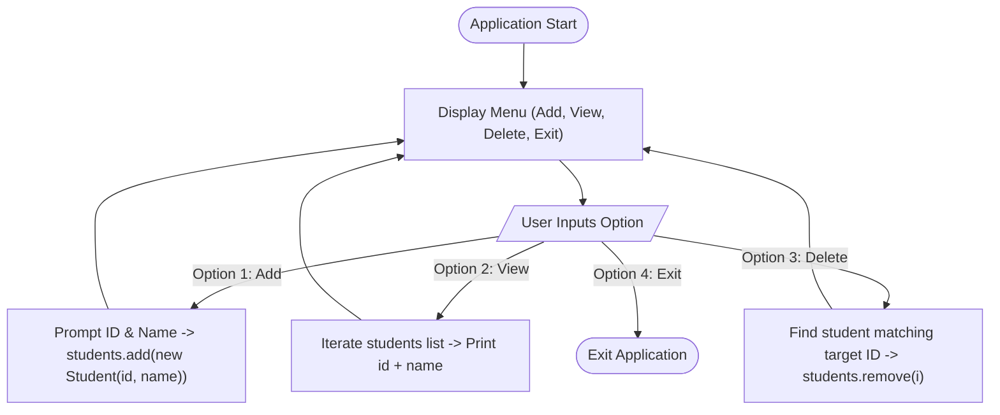

# 📅 Day 10: Modern Java Date-Time API (`java.time`) & In-Memory Collections (`ArrayList`)

<div align="center">


</div>

---

## 📖 Table of Contents
1. [🌟 Day 10 Overview](#-day-10-overview)
2. [⏰ Deep Dive: Modern Java Date & Time API (`java.time`)](#-deep-dive-modern-java-date--time-api-javatime)
   - [Why `java.time` Replaced Legacy `java.util.Date` & `Calendar`](#why-javatime-replaced-legacy-javautildate--calendar)
   - [Core Date-Time Classes Hierarchy](#core-date-time-classes-hierarchy)
   - [Stand-Alone Implementation: `today.java`](#stand-alone-implementation-todayjava)
   - [Formatting & Pattern Syntax Reference](#formatting--pattern-syntax-reference)
   - [Real-World Project Integration: Registration Timestamping](#real-world-project-integration-registration-timestamping)
3. [📦 Deep Dive: In-Memory Data Management (`ArrayList<Student>`)](#-deep-dive-in-memory-data-management-arrayliststudent)
   - [From File Storage to Dynamic Collections](#from-file-storage-to-dynamic-collections)
   - [Object-Oriented Entity Model: `Student`](#object-oriented-entity-model-student)
   - [Console CRUD Implementation: `Main.java`](#console-crud-implementation-mainjava)
   - [Safe Collection Traversal & Deletion](#safe-collection-traversal--deletion)
4. [📊 Storage Paradigms Comparison Matrix](#-storage-paradigms-comparison-matrix)
5. [🚀 Compilation & Execution Guide](#-compilation--execution-guide)

---

## 🌟 Day 10 Overview

Day 10 centered on two vital pillars of modern enterprise Java development:
1. **Modern Date & Time API (`java.time`)**: Introduced in Java 8 (JSR-310), this API resolves decades of design flaws with legacy `java.util.Date` and `Calendar` by providing immutable, thread-safe, and clear date-time representations.
2. **In-Memory Collection Management (`ArrayList<Student>`)**: Transitioning from disk-bound file persistence (`students.txt`) to dynamic in-memory collections, allowing rapid manipulation, dynamic resizing, and structured object traversal without disk overhead.

---

## ⏰ Deep Dive: Modern Java Date & Time API (`java.time`)

### Why `java.time` Replaced Legacy `java.util.Date` & `Calendar`

Prior to Java 8, date and time manipulation relied on `java.util.Date` and `java.util.Calendar`. These legacy classes had severe issues:
* **Mutability**: Instances were mutable, meaning any method could modify the timestamp, causing subtle concurrency bugs and thread-safety hazards.
* **0-Indexed Months**: In `Calendar`, January was `0` and December was `11`, leading to frequent off-by-one errors.
* **Poor Naming & Design**: `java.util.Date` actually represented both date and time (and an instant in time), while `java.sql.Date` represented only a SQL date.
* **Non-Thread-Safe Formatters**: `SimpleDateFormat` was not thread-safe, forcing developers to synchronize or create new instances per thread.

**The `java.time` Solution:**
* **Immutability**: All core classes (`LocalDate`, `LocalTime`, `LocalDateTime`, etc.) are completely immutable and thread-safe.
* **Sensible Indexing**: Months are indexed naturally (`1 = January` to `12 = December`) or accessed via the `Month` enum.
* **Separation of Concerns**: Clear distinction between human date/time and machine timestamps.
* **Thread-Safe Formatting**: `DateTimeFormatter` is thread-safe and can be reused as static constants.

### Core Date-Time Classes Hierarchy

```mermaid
graph TD
    java_time["java.time Package (JSR-310)"] --> LocalDate["LocalDate (Date without Time, e.g., 2026-10-22)"]
    java_time --> LocalTime["LocalTime (Time without Date, e.g., 10:55:01)"]
    java_time --> LocalDateTime["LocalDateTime (Date + Time, e.g., 2026-10-22T10:55:01)"]
    java_time --> ZonedDateTime["ZonedDateTime (Date + Time + ZoneId, e.g., UTC, Asia/Kolkata)"]
    
    java_time_format["java.time.format Package"] --> DateTimeFormatter["DateTimeFormatter (Thread-Safe Formatter/Parser)"]
    LocalDateTime -.-> |format(formatter)| FormattedString["Formatted String (e.g., '22-10-2026 10:55')"]
    DateTimeFormatter -.-> |Applied To| FormattedString
```

### Stand-Alone Implementation: `today.java`

File: [`Day_10/today.java`](./today.java)

```java
import java.time.LocalDate;
import java.time.LocalTime;
import java.time.LocalDateTime;
import java.time.format.DateTimeFormatter;

public class today {
    public static void main(String[] args) {
        // Capture system's current date and time
        LocalDateTime now = LocalDateTime.now();

        // Define a custom human-readable pattern
        DateTimeFormatter format = DateTimeFormatter.ofPattern("dd-MM-yyyy HH:mm");

        // Format the date-time into a String
        String result = now.format(format);

        // Display formatted timestamp
        System.out.println(result);
    }
}
```

#### Execution Output:
```text
22-10-2026 10:57
```

### Formatting & Pattern Syntax Reference

The `DateTimeFormatter.ofPattern(String pattern)` method uses pattern letters defined in Unicode CLDR:

| Pattern Symbol | Meaning | Example |
| :--- | :--- | :--- |
| `dd` | Day of the month (2 digits with leading zero) | `05`, `22` |
| `d` | Day of the month without leading zero | `5`, `22` |
| `MM` | Month number (2 digits) | `01` (Jan), `10` (Oct) |
| `MMM` | Short month name | `Oct` |
| `MMMM` | Full month name | `October` |
| `yyyy` | Year (4 digits) | `2026` |
| `HH` | Hour in 24-hour format (00–23) | `09`, `14` |
| `hh` | Hour in 12-hour format (01–12) | `09`, `02` |
| `mm` | Minute of hour (2 digits) | `05`, `57` |
| `ss` | Second of minute (2 digits) | `00`, `45` |
| `a` | AM / PM marker | `AM`, `PM` |
| `E` / `EEEE` | Day of the week (short / full) | `Thu` / `Thursday` |

### Real-World Project Integration: Registration Timestamping

The Date-Time API was integrated directly into the **Student Management System** in [`Day_8/Student_Project/StudentDao.java`](../Day_8/Student_Project/StudentDao.java).

Whenever a new student is registered:
1. `LocalDateTime.now()` retrieves the current system timestamp.
2. `DateTimeFormatter.ofPattern("dd-MM-yyyy HH:mm")` formats it to a clean human-readable representation.
3. The timestamp is persisted alongside the student details:
   ```text
   567,rohan (Added: 21-10-2026 14:53)
   ```
4. When viewing the student list via `readStudents()`, users see the exact registration timestamp for auditability.

---

## 📦 Deep Dive: In-Memory Data Management (`ArrayList<Student>`)

### From File Storage to Dynamic Collections

In Day 8, students were persisted directly to disk using `FileWriter` and `BufferedReader`. In Day 10, we transitioned to in-memory collection management using Java's `ArrayList<T>`.

#### Why `ArrayList<T>` over Native Arrays (`Student[]`)?
* **Dynamic Sizing**: Standard Java arrays have a fixed length declared at initialization. `ArrayList` dynamically expands and contracts its internal capacity as elements are added or deleted.
* **Rich Collection API**: Built-in methods like `add()`, `remove()`, `get()`, `size()`, `clear()`, and `contains()` eliminate manual index management.
* **Type Safety with Generics**: `ArrayList<Student>` enforces that only `Student` objects are stored, eliminating runtime `ClassCastException`.

### Object-Oriented Entity Model: `Student`

The `Student` class follows POJO (Plain Old Java Object) encapsulation best practices:



```java
class Student {
    private int id;
    private String name;

    public Student(int id, String name) {
        this.id = id;
        this.name = name;
    }

    public int getId() { return id; }
    public void setId(int id) { this.id = id; }
    public String getName() { return name; }
    public void setName(String name) { this.name = name; }
}
```

### Console CRUD Implementation: `Main.java`

File: [`Day_10/Main.java`](./Main.java)

The console application provides an interactive menu loop for managing student records entirely in JVM memory:



### Safe Collection Traversal & Deletion

When removing items from a collection during iteration, naïve loops can trigger `ConcurrentModificationException` or index-shifting anomalies:

```java
case 3:
    System.out.print("Enter ID of student to delete: ");
    int delId = sc.nextInt();
    for (Student i : students) {
        if (i.getId() == delId) {
            students.remove(i);
            System.out.println("Student deleted successfully!");
            break; // Essential: break avoids ConcurrentModificationException on modified collection
        }
    }
    break;
```

> [!TIP]
> **Why `break` is critical**: When `students.remove(i)` is called, the internal structure of the `ArrayList` changes. Breaking immediately after finding and deleting the target prevents the iterator from advancing across a modified list, ensuring safe and predictable execution.

---

## 📊 Storage Paradigms Comparison Matrix

| Dimension | File I/O (`Day_8`: `students.txt`) | In-Memory Collections (`Day_10`: `ArrayList`) | Relational Database (Future / SQL) |
| :--- | :--- | :--- | :--- |
| **Persistence** | Permanent (persists across application restarts) | Volatile (lost once application terminates) | Permanent (ACID transactions, durable storage) |
| **Access Speed** | Slower (Disk I/O latency) | Instantaneous (Nanosecond RAM access) | Fast (optimized indexing & caching) |
| **Search / Query** | Manual sequential line scanning (`O(N)`) | Object methods & Stream API (`O(N)`) | Declarative SQL queries (`O(log N)` via B-Trees) |
| **Concurrency** | File locking and write collision risks | Thread-safe options (`CopyOnWriteArrayList`, Sync) | Built-in multi-client transaction isolation |
| **Complexity** | Requires file stream handling & formatting | Very simple and intuitive | Requires driver, connection pooling & ORM |

---

## 🚀 Compilation & Execution Guide

### 1. Running the Date-Time Demonstration (`today.java`)

Navigate to the workspace root and compile/run `today.java`:

```powershell
# Compile
javac Day_10/today.java

# Run
java -cp Day_10 today
```

**Sample Output:**
```text
22-10-2026 10:57
```

---

### 2. Running the In-Memory Student Management System (`Main.java`)

```powershell
# Compile
javac Day_10/Main.java

# Run
java -cp Day_10 Main
```

**Interactive Walkthrough:**
```text
Welcome to the Student Management System!

1. Add Student  2. View Students  3. Delete Student  4. Exit
Enter your choice: 1
Enter Student ID: 101
Enter Student Name: Aasrith Sairam

1. Add Student  2. View Students  3. Delete Student  4. Exit
Enter your choice: 1
Enter Student ID: 102
Enter Student Name: John Doe

1. Add Student  2. View Students  3. Delete Student  4. Exit
Enter your choice: 2
101 Aasrith Sairam
102 John Doe

1. Add Student  2. View Students  3. Delete Student  4. Exit
Enter your choice: 3
Enter ID of student to delete: 102
Student deleted successfully!

1. Add Student  2. View Students  3. Delete Student  4. Exit
Enter your choice: 2
101 Aasrith Sairam

1. Add Student  2. View Students  3. Delete Student  4. Exit
Enter your choice: 4
Exiting program...
```

---

### 3. Running the Persistent Student Project with Date-Time Timestamps (`Day_8/Student_Project`)

```powershell
# Compile
javac Day_8/Student_Project/*.java

# Run
java -cp Day_8/Student_Project Main
```

---

<p align="center">
  <i>Documented and maintained with ❤️ by Ponguru Aasrith Sairam</i>
</p>
