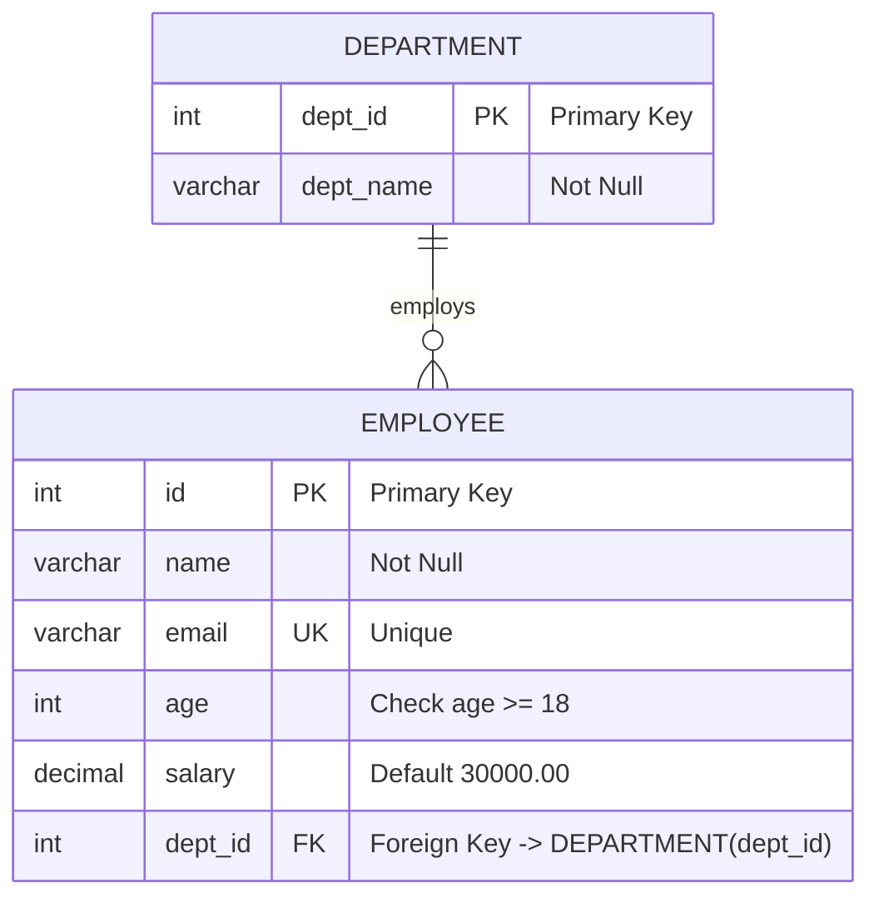
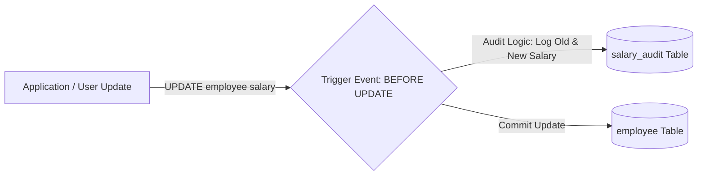

# 📅 Day 12: Relational Databases & SQL (Constraints, Clauses, Aggregates & Triggers)

<div align="center">


</div>

---

## 📖 Table of Contents
1. [🌟 Day 12 Overview](#-day-12-overview)
2. [🗄️ Relational Schema Design](#️-relational-schema-design)
3. [🛡️ SQL Constraints In-Depth](#️-sql-constraints-in-depth)
   - [`PRIMARY KEY`](#primary-key)
   - [`FOREIGN KEY`](#foreign-key)
   - [`NOT NULL`](#not-null)
   - [`UNIQUE`](#unique)
   - [`CHECK`](#check)
   - [`DEFAULT`](#default)
4. [🔍 SQL Clauses & Data Manipulation](#-sql-clauses--data-manipulation)
   - [`WHERE` vs. `HAVING`](#where-vs-having)
   - [`ORDER BY`](#order-by)
   - [`GROUP BY`](#group-by)
   - [`DISTINCT`](#distinct)
   - [`LIMIT`](#limit)
5. [📈 Aggregate Functions](#-aggregate-functions)
6. [🎯 Pattern Matching & NULL Checking (`LIKE` & `IS`)](#-pattern-matching--null-checking-like--is)
7. [⚡ SQL Triggers](#-sql-triggers)
8. [📝 Assigned Practice Tasks & Solutions](#-assigned-practice-tasks--solutions)
   - [Task 1: Display Employees with Salary > 35,000](#task-1-display-employees-with-salary--35000)
   - [Task 2: Display Employees Sorted by Salary in Descending Order](#task-2-display-employees-sorted-by-salary-in-descending-order)
   - [Task 3: Display Number of Employees in Each Department](#task-3-display-number-of-employees-in-each-department)

---

## 🌟 Day 12 Overview

Day 12 introduced relational database fundamentals using SQL. We explored how data integrity is maintained at the database engine level using constraints, how complex analytical queries are composed using clauses and aggregate functions, and how automated actions are executed using event-driven database **Triggers**.

All runnable queries for this session are organized in [`Day_12/queries.sql`](./queries.sql).

---

## 🗄️ Relational Schema Design

To demonstrate relational integrity, foreign keys, and analytical queries, two tables were designed: `department` (parent) and `employee` (child).



---

## 🛡️ SQL Constraints In-Depth

Constraints enforce business and domain rules at the schema level, preventing invalid data from entering the database.

```sql
CREATE TABLE department (
    dept_id INT PRIMARY KEY,
    dept_name VARCHAR(50) NOT NULL
);

CREATE TABLE employee (
    id INT PRIMARY KEY,
    name VARCHAR(50) NOT NULL,
    email VARCHAR(100) UNIQUE,
    age INT CHECK (age >= 18),
    salary DECIMAL(10, 2) DEFAULT 30000.00,
    dept_id INT,
    FOREIGN KEY (dept_id) REFERENCES department(dept_id)
);
```

| Constraint | Purpose | Implementation Example |
| :--- | :--- | :--- |
| **`PRIMARY KEY`** | Uniquely identifies each record in a table. Implies `UNIQUE` + `NOT NULL`. | `id INT PRIMARY KEY` |
| **`NOT NULL`** | Guarantees that a column cannot store `NULL` values. | `name VARCHAR(50) NOT NULL` |
| **`UNIQUE`** | Guarantees that all values in a column are distinct. | `email VARCHAR(100) UNIQUE` |
| **`CHECK`** | Verifies that all values in a column satisfy a boolean condition. | `age INT CHECK (age >= 18)` |
| **`DEFAULT`** | Assigns a fallback value when no value is provided on insertion. | `salary DECIMAL(10, 2) DEFAULT 30000.00` |
| **`FOREIGN KEY`** | Preserves referential integrity by pointing to a primary key in another table. | `FOREIGN KEY (dept_id) REFERENCES department(dept_id)` |

---

## 🔍 SQL Clauses & Data Manipulation

### `WHERE` vs. `HAVING`
* **`WHERE`**: Filters individual rows **before** any aggregation takes place.
* **`HAVING`**: Filters grouped rows **after** `GROUP BY` aggregation takes place.

```sql
SELECT * FROM employee WHERE age > 21;

SELECT dept_id, COUNT(*) AS emp_count
FROM employee
WHERE dept_id IS NOT NULL
GROUP BY dept_id
HAVING COUNT(*) > 1;
```

### `ORDER BY`
Sorts query results in either ascending (`ASC`, default) or descending (`DESC`) order:
```sql
SELECT * FROM employee ORDER BY name ASC;
SELECT * FROM employee ORDER BY salary DESC;
```

### `GROUP BY`
Groups rows that share identical values in specified columns to apply aggregate calculations:
```sql
SELECT dept_id, COUNT(*) AS total_employees 
FROM employee 
GROUP BY dept_id;
```

### `DISTINCT`
Removes duplicate entries from the result set:
```sql
SELECT DISTINCT dept_id FROM employee;
```

### `LIMIT`
Constrains the maximum number of rows returned by the query:
```sql
SELECT * FROM employee LIMIT 3;
```

---

## 📈 Aggregate Functions

Aggregate functions perform computations on a set of column values and return a single summary value:

```sql
SELECT 
    MIN(salary) AS minimum_salary,
    MAX(salary) AS maximum_salary,
    AVG(salary) AS average_salary,
    SUM(salary) AS total_payroll,
    COUNT(*) AS total_employees
FROM employee;
```

| Function | Description |
| :--- | :--- |
| **`MIN()`** | Returns the smallest value in a column. |
| **`MAX()`** | Returns the largest value in a column. |
| **`AVG()`** | Calculates the arithmetic mean of a numeric column. |
| **`SUM()`** | Computes the total sum of all values in a numeric column. |
| **`COUNT()`** | Returns the total count of rows or non-null values. |

---

## 🎯 Pattern Matching & NULL Checking (`LIKE` & `IS`)

### 1. `LIKE` Operator
Used in `WHERE` clauses for search patterns:
* `%` represents zero, one, or multiple characters.
* `_` represents a single character.

```sql
SELECT * FROM employee WHERE name LIKE 'A%';

SELECT * FROM employee WHERE email LIKE '%gmail%';
```

### 2. `IS` Operator
Because `NULL` signifies unknown or absence of data, standard comparison operators (`=` or `!=`) cannot be used. We use `IS NULL` and `IS NOT NULL`:

```sql
SELECT * FROM employee WHERE dept_id IS NULL;

SELECT * FROM employee WHERE dept_id IS NOT NULL;
```

---

## ⚡ SQL Triggers

A **Trigger** is a database object that automatically executes in response to a specific event (`INSERT`, `UPDATE`, or `DELETE`) on a designated table.



### Trigger Implementation Example: Salary Audit Log

```sql
CREATE TABLE salary_audit (
    audit_id INT AUTO_INCREMENT PRIMARY KEY,
    emp_id INT,
    old_salary DECIMAL(10, 2),
    new_salary DECIMAL(10, 2),
    changed_at TIMESTAMP DEFAULT CURRENT_TIMESTAMP
);

DELIMITER //
CREATE TRIGGER trg_salary_update_audit
BEFORE UPDATE ON employee
FOR EACH ROW
BEGIN
    IF OLD.salary <> NEW.salary THEN
        INSERT INTO salary_audit (emp_id, old_salary, new_salary)
        VALUES (OLD.id, OLD.salary, NEW.salary);
    END IF;
END //
DELIMITER ;
```

---

## 📝 Assigned Practice Tasks & Solutions

### Task 1: Display Employees with Salary > 35,000

```sql
SELECT id, name, email, age, salary, dept_id
FROM employee
WHERE salary > 35000.00;
```

**Sample Output:**
| id | name | email | age | salary | dept_id |
| :--- | :--- | :--- | :--- | :--- | :--- |
| 101 | Aasrith Sairam | aasrith@gmail.com | 21 | 55000.00 | 1 |
| 102 | Rohith Kumar | rohith@gmail.com | 22 | 42000.00 | 1 |
| 103 | Senthil Nathan | senthil@gmail.com | 24 | 38000.00 | 2 |
| 104 | Vijay Anand | vijay@gmail.com | 25 | 48000.00 | 3 |
| 106 | Sneha Reddy | sneha@gmail.com | 23 | 36000.00 | 1 |

---

### Task 2: Display Employees Sorted by Salary in Descending Order

```sql
SELECT id, name, email, age, salary, dept_id
FROM employee
ORDER BY salary DESC;
```

**Sample Output:**
| id | name | email | age | salary | dept_id |
| :--- | :--- | :--- | :--- | :--- | :--- |
| 101 | Aasrith Sairam | aasrith@gmail.com | 21 | 55000.00 | 1 |
| 104 | Vijay Anand | vijay@gmail.com | 25 | 48000.00 | 3 |
| 102 | Rohith Kumar | rohith@gmail.com | 22 | 42000.00 | 1 |
| 103 | Senthil Nathan | senthil@gmail.com | 24 | 38000.00 | 2 |
| 106 | Sneha Reddy | sneha@gmail.com | 23 | 36000.00 | 1 |
| 105 | Pooja Sri | pooja@gmail.com | 20 | 32000.00 | 2 |
| 107 | Karan Sharma | karan@gmail.com | 19 | 30000.00 | 4 |
| 108 | Aditi Rao | aditi@gmail.com | 26 | 29000.00 | NULL |

---

### Task 3: Display Number of Employees in Each Department

#### Query 3A: Department ID Grouping
```sql
SELECT dept_id, COUNT(*) AS number_of_employees
FROM employee
WHERE dept_id IS NOT NULL
GROUP BY dept_id;
```

#### Query 3B: Joined with Department Name
```sql
SELECT d.dept_name, COUNT(e.id) AS number_of_employees
FROM department d
LEFT JOIN employee e ON d.dept_id = e.dept_id
GROUP BY d.dept_id, d.dept_name;
```

**Sample Output:**
| dept_name | number_of_employees |
| :--- | :--- |
| Engineering | 3 |
| Human Resources | 2 |
| Finance | 1 |
| Marketing | 1 |

---

<p align="center">
  <i>Documented and maintained with ❤️ by Ponguru Aasrith Sairam</i>
</p>
