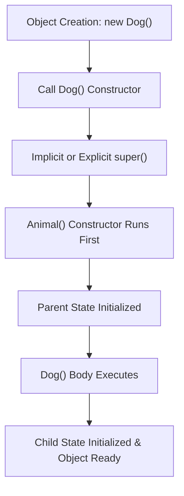
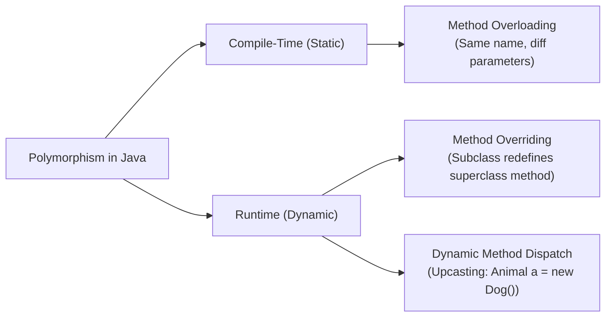
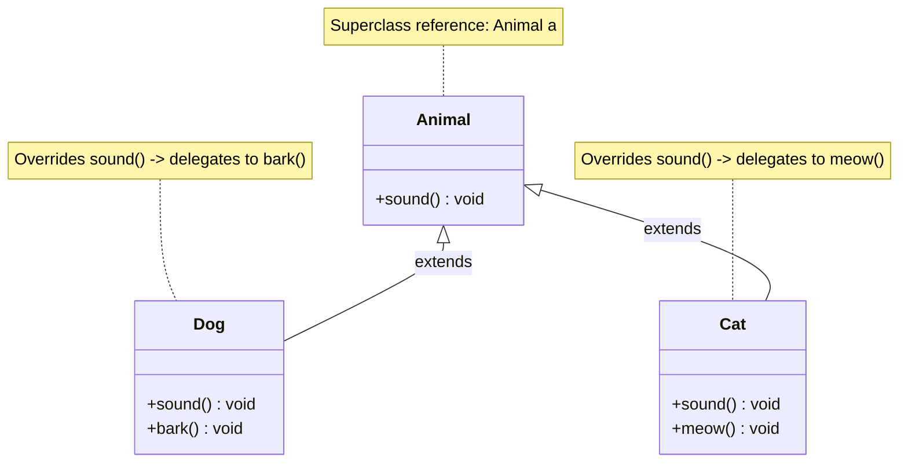
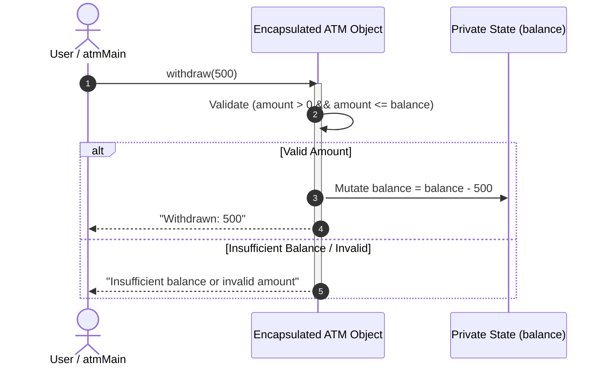
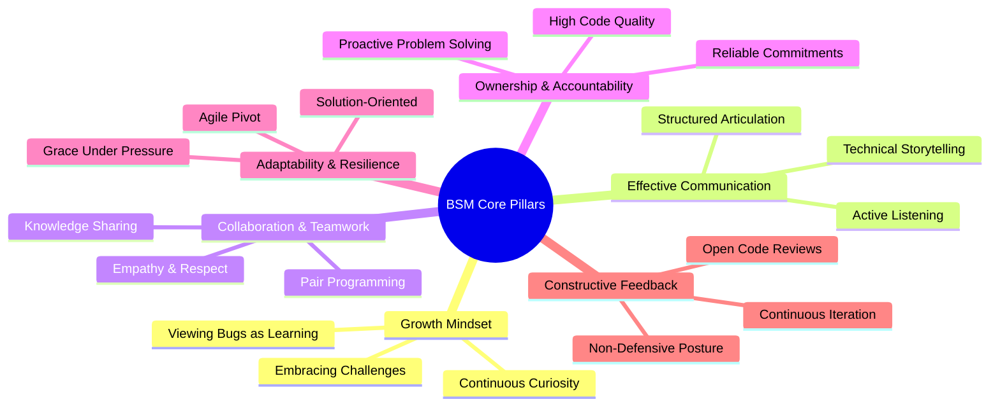

# 📅 Day 5: Object-Oriented Programming (OOP) Deep Dive & BSM (Behaviour Skills Mindset)

<div align="center">


</div>

---

## 📖 Table of Contents
1. [🌟 Day 5 Overview](#-day-5-overview)
2. [🏗️ Deep Dive: Constructors in Java](#️-deep-dive-constructors-in-java)
   - [What is a Constructor?](#what-is-a-constructor)
   - [Constructor Characteristics & Rules](#constructor-characteristics--rules)
   - [Types of Constructors](#types-of-constructors)
   - [Constructor Overloading & Chaining (`this` and `super`)](#constructor-overloading--chaining-this-and-super)
   - [Object Memory Lifecycle & Heap Allocation](#object-memory-lifecycle--heap-allocation)
3. [🎭 Deep Dive: Polymorphism](#-deep-dive-polymorphism)
   - [What is Polymorphism?](#what-is-polymorphism)
   - [Compile-Time Polymorphism (Static Binding)](#compile-time-polymorphism-static-binding)
   - [Runtime Polymorphism (Dynamic Method Dispatch)](#runtime-polymorphism-dynamic-method-dispatch)
   - [Upcasting & Dynamic Binding Mechanism](#upcasting--dynamic-binding-mechanism)
   - [Polymorphism Architecture Diagram](#polymorphism-architecture-diagram)
4. [🛡️ Deep Dive: Encapsulation & Data Hiding](#️-deep-dive-encapsulation--data-hiding)
   - [The Philosophy of Encapsulation](#the-philosophy-of-encapsulation)
   - [Data Hiding with Access Modifiers (`private`)](#data-hiding-with-access-modifiers-private)
   - [Controlled Access via Getters and Setters](#controlled-access-via-getters-and-setters)
   - [Business Logic & Invariant Validation](#business-logic--invariant-validation)
   - [Encapsulation Flow Diagram](#encapsulation-flow-diagram)
5. [🧠 Behaviour Skills Mindset (BSM)](#-behaviour-skills-mindset-bsm)
   - [What is BSM?](#what-is-bsm)
   - [Core Pillars of Corporate Readiness](#core-pillars-of-corporate-readiness)
   - [Applying BSM to Software Engineering at UPS](#applying-bsm-to-software-engineering-at-ups)
6. [💻 Detailed Codebase Walkthrough](#-detailed-codebase-walkthrough)
   - [1. `Main.java` — Dynamic Employee Directory & Object Arrays](#1-mainjava--dynamic-employee-directory--object-arrays)
   - [2. `Main2.java` (`Animal`, `Dog`, `Cat`) — Runtime Polymorphism](#2-main2java-animal-dog-cat--runtime-polymorphism)
   - [3. `ATM.java` — Robust Encapsulation Engine](#3-atmjava--robust-encapsulation-engine)
   - [4. `atmMain.java` — Interactive Banking Console Application](#4-atmmainjava--interactive-banking-console-application)
7. [📊 Summary & Comparison Matrix](#-summary--comparison-matrix)
8. [🚀 Compilation & Execution Guide](#-compilation--execution-guide)

---

## 🌟 Day 5 Overview

Day 5 marked a major milestone in our Java Full Stack journey with UPS. Moving beyond procedural basics and simple control flow, we plunged headfirst into the core pillars of **Object-Oriented Programming (OOP)**:
* **Constructors**: Demystifying how objects come to life, allocating heap memory, and initializing class state.
* **Polymorphism**: Enabling objects of different types to respond to the same interface or method call in their own unique manner.
* **Encapsulation**: Securing object state from unauthorized modification while exposing clean, validated interfaces.
* **BSM (Behaviour Skills Mindset)**: Cultivating essential professional attitudes, emotional intelligence, collaborative communication, and workplace excellence required in modern software enterprises like UPS.

---

## 🏗️ Deep Dive: Constructors in Java

### What is a Constructor?
In Java, a **Constructor** is a special block of code that is invoked automatically when an instance (object) of a class is created using the `new` keyword. Its primary responsibility is to initialize the freshly allocated memory for the object and assign valid initial values to instance fields.

```java
// Syntax of a Constructor
public class Box {
    int length;

    // Constructor declaration
    public Box(int l) {
        this.length = l; // State initialization
    }
}
```

### Constructor Characteristics & Rules
1. **Name Matching:** The constructor name must match the class name character-for-character, including casing.
2. **No Return Type:** A constructor has **no return type**, not even `void`. (If a return type like `void` is declared, Java treats it as a regular method rather than a constructor).
3. **Implicit Execution:** It is triggered exclusively during object creation via `new ClassName()`.
4. **Cannot Be Abstract, Static, or Final:** Since constructors are bound to an instance being constructed, modifiers like `static`, `abstract`, or `final` are illegal.

### Types of Constructors

| Constructor Type | Description | Example |
| :--- | :--- | :--- |
| **Default Constructor** | Automatically generated by the Java compiler if and only if no explicit constructor is defined in the source code. It sets fields to default zero values (`0`, `null`, `false`). | `Employee() {}` (auto-created) |
| **No-Argument Constructor** | A constructor written explicitly by the developer taking zero parameters. Used for default custom initialization. | `public Employee() { this.id = 0; }` |
| **Parameterized Constructor** | A constructor accepting one or more arguments, allowing caller to instantiate objects with custom initial states. | `public Employee(int id, String name) { ... }` |

### Constructor Overloading & Chaining (`this` and `super`)
* **Constructor Overloading:** Defining multiple constructors with different parameter signatures within the same class.
* **`this(...)` (Current Class Chaining):** Calls another constructor within the same class. It must always be the **first line** of the constructor body.
* **`super(...)` (Parent Class Chaining):** Calls a constructor of the parent class. If omitted, Java automatically inserts `super()` as the first statement, ensuring parent classes are constructed before child classes.



### Object Memory Lifecycle & Heap Allocation
1. **Compilation (`javac`):** Bytecode instructions include `new`, `dup`, and `invokespecial <init>`.
2. **Allocation:** JVM allocates heap space for the object's instance fields.
3. **Zero Initialization:** Fields receive default values (`0`, `null`, `false`).
4. **Explicit Constructor Call:** The `<init>` method executes, running initializer blocks and constructor code.
5. **Reference Assignment:** The memory address of the heap object is stored into the reference variable on the stack.

---

## 🎭 Deep Dive: Polymorphism

### What is Polymorphism?
Derived from the Greek words **Poly** (*many*) and **Morph** (*forms*), **Polymorphism** is the ability of a single interface, method, or reference to represent different underlying forms (data types or behaviors).

In Java, Polymorphism is classified into two distinct types:
1. **Compile-Time Polymorphism (Static Binding / Method Overloading)**
2. **Runtime Polymorphism (Dynamic Binding / Method Overriding)**



### Compile-Time Polymorphism (Static Binding)
* **Mechanism:** Achieved through **Method Overloading**.
* **Resolution:** The compiler binds the method call to the method definition at compile time based on method signatures (argument count, data types, and parameter order).
* **Speed:** Extremely fast with zero runtime overhead because the decision is made prior to execution.

### Runtime Polymorphism (Dynamic Method Dispatch)
* **Mechanism:** Achieved through **Method Overriding** and **Upcasting**.
* **Condition:** Occurs when a subclass provides its own specific implementation of a method already declared in its superclass.
* **Dynamic Method Dispatch:** When an overridden method is called through a superclass reference variable, Java decides which version of the method to execute **at runtime** based on the actual object instance present on the heap, rather than the type of the reference variable.

### Upcasting & Dynamic Binding Mechanism
```java
Animal a;          // Reference of superclass type 'Animal'

a = new Dog();     // Upcasting: Dog object assigned to Animal reference
a.sound();         // Output: Dog is barking (Dynamic dispatch resolves to Dog.sound())

a = new Cat();     // Upcasting: Cat object assigned to Animal reference
a.sound();         // Output: Cat is meowing (Dynamic dispatch resolves to Cat.sound())
```

### Polymorphism Architecture Diagram


---

## 🛡️ Deep Dive: Encapsulation & Data Hiding

### The Philosophy of Encapsulation
**Encapsulation** is the OOP mechanism of binding data (variables/state) and the methods that operate on that data into a cohesive, self-contained unit (class), while hiding the internal state from unrestricted outside access.

It is frequently referred to as **Data Hiding** or the **Principle of Least Privilege**.

### Data Hiding with Access Modifiers (`private`)
Without encapsulation, any external code could maliciously or accidentally tamper with internal state:
```java
// BAD: Unrestricted direct field access
class FlawedATM {
    public double balance; // Anyone can corrupt this!
}
FlawedATM atm = new FlawedATM();
atm.balance = -9999999; // Corrupted! Negative money does not make sense.
```

With encapsulation, we hide the field using the `private` modifier:
```java
// GOOD: Encapsulated field
public class ATM {
    private double balance; // Hidden from direct external access!
}
```

### Controlled Access via Getters and Setters
To safely view and modify the hidden state, we provide `public` accessor (getter) and mutator (setter) methods.

```java
public double getBalance() {
    return balance;
}

public void setBalance(double balance) {
    if (balance >= 0) { // Invariant check!
        this.balance = balance;
    }
}
```

### Business Logic & Invariant Validation
Encapsulation allows classes to enforce business constraints:
* **Deposit Validation:** Ensures that deposited money must be strictly positive (`amount > 0`).
* **Withdrawal Validation:** Protects against overdrafts by checking that funds are available (`amount > 0 && amount <= balance`).
* **Audit Trails & Security:** Logging, transaction history, or security checks can be inserted into the setter/methods without breaking calling code.

### Encapsulation Flow Diagram


---

## 🧠 Behaviour Skills Mindset (BSM)

In addition to core technical programming concepts, Day 5 integrated **Behaviour Skills Mindset (BSM)** training. In enterprise environments like **UPS**, strong technical aptitude must be complemented by behavioural maturity, empathy, and a corporate mindset.



### Core Pillars of Corporate Readiness
1. **Growth Mindset vs. Fixed Mindset:**
   - Shifting from *"I don't know how to do this"* to *"I don't know how to do this yet."*
   - Embracing debugging and compiler errors as natural steps toward mastery.
2. **Clear & Structured Communication:**
   - Articulating technical ideas concisely to peers, mentors, and non-technical stakeholders.
   - Practicing **Active Listening** to ensure requirements are fully understood before jumping into code.
3. **Collaboration & Pair Programming:**
   - Working synchronously with peers to analyze problems, brainstorm edge cases, and review logic.
   - Valuing diverse perspectives and maintaining humility.
4. **Ownership & Accountability:**
   - Taking full responsibility for your code quality, architecture, test cases, and deadlines.
   - Treating software not as isolated exercises, but as critical business solutions.
5. **Adaptability & Resilience:**
   - Navigating unexpected requirement shifts, unfamiliar libraries, and tight delivery schedules with poise.
6. **Receiving & Giving Constructive Feedback:**
   - Treating code reviews as opportunities for shared growth rather than personal criticism.

### Applying BSM to Software Engineering at UPS
At UPS, logistics and technology infrastructure operate at immense scale where millions of packages and critical systems run 24/7. Writing code that is maintainable, clean, and well-encapsulated is a direct reflection of personal integrity and professional accountability. BSM bridges the gap between being a "coder" and becoming a high-impact "Software Engineer".

---

## 💻 Detailed Codebase Walkthrough

Let's review the practical Java programs written during Day 5:

### 1. `Main.java` — Dynamic Employee Directory & Object Arrays
* **File:** [`Main.java`](file:///c:/clg/UPS_Training/Day_5/Main.java)
* **Key Concepts:** Object instantiation, Reference Arrays (`Employee[]`), Dynamic allocation with `Scanner`, Iteration over objects.

#### Architecture & Logic
In `Main.java`, we model an `Employee` entity with attributes `id` and `name`. We demonstrate how Java treats arrays of objects:
1. `Employee[] empList = new Employee[count];` creates an array of **null references**.
2. A loop instantiates each individual `Employee` object on the heap (`empList[i] = new Employee();`).
3. User inputs are collected dynamically via `Scanner` and populated into fields.
4. A second loop traverses the array and invokes `printDetails()` on each object.

```java
import java.util.Scanner;

class Employee {
    int id;
    String name;
    void printDetails() {
        System.out.println("ID: " + id + " | Name: " + name);
    }
}

public class Main {
    public static void main(String[] args) {
        Scanner sc = new Scanner(System.in);
        System.out.print("Enter number of employees: ");
        int count = sc.nextInt();
        Employee[] empList = new Employee[count];

        for (int i = 0; i < count; i++) {
            empList[i] = new Employee();
            System.out.println("\nEnter details for Employee " + (i + 1) + ":");
            System.out.print("Enter ID: ");
            empList[i].id = sc.nextInt();
            System.out.print("Enter Name: ");
            empList[i].name = sc.next();
        }

        System.out.println("\nEmployee List: ");
        for (int i = 0; i < count; i++) {
            empList[i].printDetails();
        }
    }
}
```

---

### 2. `Main2.java` (`Animal`, `Dog`, `Cat`) — Runtime Polymorphism
* **File:** [`Main2.java`](file:///c:/clg/UPS_Training/Day_5/Main2.java)
* **Key Concepts:** Class Inheritance (`extends`), Method Overriding, Upcasting, Dynamic Method Dispatch.
* **Note on Structure:** The `Animal`, `Dog`, and `Cat` classes are structured within `Main2.java` as package-private classes alongside `public class Main2`. When compiled with `javac Main2.java`, the compiler generates separate bytecode files (`Animal.class`, `Dog.class`, `Cat.class`, and `Main2.class`).

#### Architecture & Logic
```java
class Animal {
    void sound() {
    }
}

class Dog extends Animal {
    void sound() {
        bark();
    }
    void bark() {
        System.out.println("Dog is barking");
    }
}

class Cat extends Animal {
    void sound() {
        meow();
    }
    void meow() {
        System.out.println("Cat is meowing");
    }
}

public class Main2 {
    public static void main(String[] args) {
        Animal a; // Superclass reference

        a = new Dog(); // Upcasting
        a.sound();     // Dispatches to Dog's sound() -> "Dog is barking"

        a = new Cat(); // Upcasting
        a.sound();     // Dispatches to Cat's sound() -> "Cat is meowing"
    }
}
```

#### How Dynamic Dispatch Works Here:
1. `Animal a;` allocates a reference variable on the stack of type `Animal`.
2. `a = new Dog();` creates a `Dog` object in heap memory and assigns its address to `a`.
3. When `a.sound()` is called, the JVM looks up the Virtual Method Table (vtable) of the actual heap object (`Dog`) and invokes `Dog.sound()`, which outputs `"Dog is barking"`.
4. Next, `a = new Cat();` re-binds the reference to a `Cat` instance.
5. Calling `a.sound()` now executes `Cat.sound()`, outputting `"Cat is meowing"`.
6. This showcases the essence of Polymorphism: **One interface (`a.sound()`), multiple behaviors!**

---

### 3. `ATM.java` — Robust Encapsulation Engine
* **File:** [`ATM.java`](file:///c:/clg/UPS_Training/Day_5/ATM.java)
* **Key Concepts:** Data Hiding (`private double balance`), Accessor (`getBalance`), Mutator (`setBalance`), Defensive Programming.

#### Architecture & Logic
`ATM.java` encapsulates a customer's account balance. It disallows external code from directly reading or modifying the field:
* `setBalance(double balance)` ensures balance cannot be set to a negative number.
* `deposit(double amount)` validates that deposit increments are strictly greater than zero.
* `withdraw(double amount)` prevents unauthorized overdrafts by verifying `amount <= getBalance()`.

```java
public class ATM {
    private double balance;

    public double getBalance() {
        return balance;
    }

    public void setBalance(double balance) {
        if (balance >= 0) {
            this.balance = balance;
        }
    }

    public void checkBalance() {
        System.out.println("Current Balance: " + getBalance());
    }

    public void deposit(double amount) {
        if (amount > 0) {
            setBalance(getBalance() + amount);
            System.out.println("Deposited: " + amount);
        } else {
            System.out.println("Invalid deposit amount");
        }
    }

    public void withdraw(double amount) {
        if (amount > 0 && amount <= getBalance()) {
            setBalance(getBalance() - amount);
            System.out.println("Withdrawn: " + amount);
        } else {
            System.out.println("Insufficient balance or invalid amount");
        }
    }
}
```

---

### 4. `atmMain.java` — Interactive Banking Console Application
* **File:** [`atmMain.java`](file:///c:/clg/UPS_Training/Day_5/atmMain.java)
* **Key Concepts:** UI/Controller separation, Console interaction via `Scanner`, State-driven while loop (`running`), Real-world application of the `ATM` model.

#### Architecture & Logic
`atmMain` acts as the user interface layer that consumes the business logic encapsulated inside `ATM`:
1. Initializes an `ATM` instance with an initial balance of `1000`.
2. Presents a dynamic, recurring menu to the user:
   - `1. Check Balance`
   - `2. Deposit`
   - `3. Withdraw`
   - `4. Exit`
3. Dispatches commands to the `ATM` object while keeping internal banking rules isolated from the UI logic.

```java
import java.util.Scanner;

public class atmMain {
    public static void main(String[] args) {
        Scanner sc = new Scanner(System.in);
        ATM atm = new ATM();
        atm.setBalance(1000); // Initial balance setup
        boolean running = true;

        while (running) {
            System.out.println("\n1.Check Balance  2.Deposit  3.Withdraw  4.Exit");
            System.out.print("Enter choice: ");
            int choice = sc.nextInt();

            if (choice == 1) {
                atm.checkBalance();
            } else if (choice == 2) {
                System.out.print("Enter deposit amount: ");
                double amt = sc.nextDouble();
                atm.deposit(amt);
            } else if (choice == 3) {
                System.out.print("Enter withdraw amount: ");
                double amt = sc.nextDouble();
                atm.withdraw(amt);
            } else if (choice == 4) {
                running = false;
                System.out.println("Thank you for using the ATM!");
            } else {
                System.out.println("Invalid choice!");
            }
        }
    }
}
```

---

## 📊 Summary & Comparison Matrix

| Concept | What It Is | Real-World Analog | How It Was Implemented on Day 5 |
| :--- | :--- | :--- | :--- |
| **Constructor** | Special method to initialize object state during creation | Manufacturing assembly line stamping initial specs | Default/no-arg constructors invoked via `new Employee()` & `new ATM()` |
| **Polymorphism** | Ability for a message or method call to behave differently based on object type | A universal remote controlling both a TV and Soundbar | `Animal a = new Dog(); a.sound();` switching seamlessly to `Cat` |
| **Encapsulation** | Hiding private state and exposing safe, validated operations | A medical capsule protecting the medicine until ingested | `ATM` class protecting `private double balance` via validated getters/setters |
| **BSM** | Professional behavioral mindset, communication, and workplace readiness | Professional code of conduct & emotional intelligence | Team alignment, active listening, growth mindset, and code accountability |

---

## 🚀 Compilation & Execution Guide

To run any of the programs locally from the command line:

### 1. Compile the Java Files
```bash
# Navigate to Day_5 directory
cd Day_5

# Compile individual programs
javac Main.java
javac Main2.java
javac ATM.java atmMain.java
```

### 2. Execute the Programs
```bash
# Run Employee Directory
java Main

# Run Animal Polymorphism Demo
java Main2

# Run Interactive ATM Console App
java atmMain
```

---

<p align="center">
  <i>Documented with ❤️ as part of UPS Java Full Stack Training — Day 5</i>
</p>
