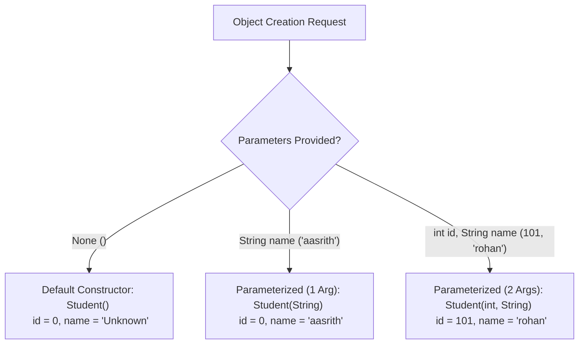
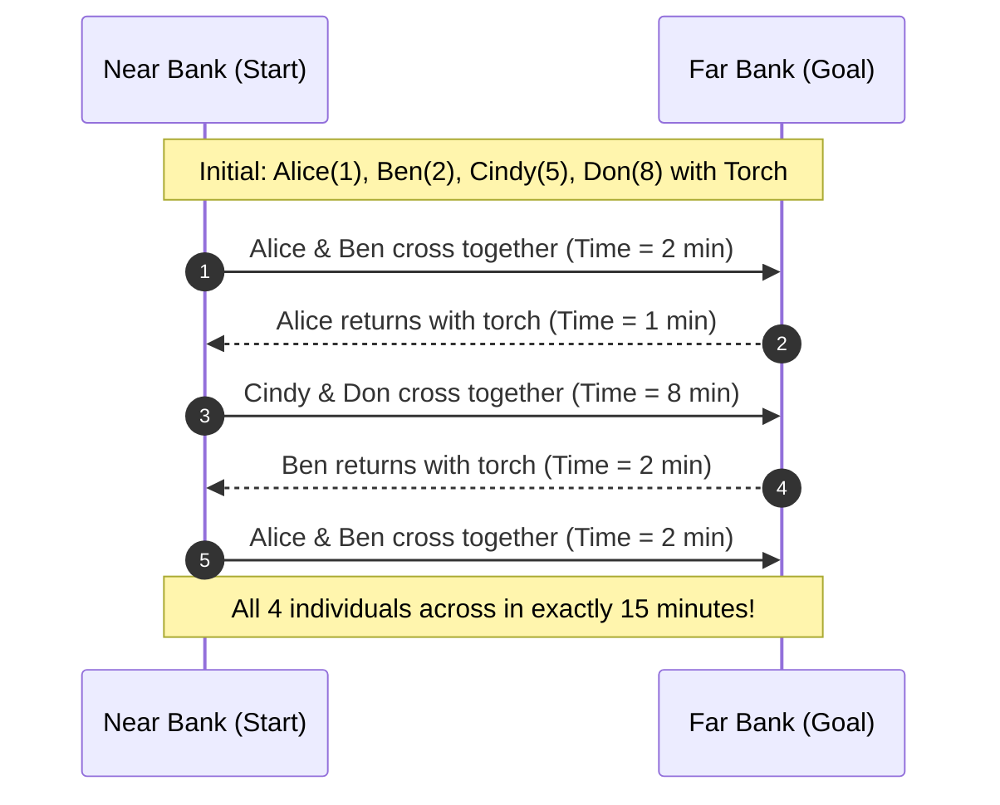

# 📅 Day 6: Constructor Overloading, String Built-in Methods, Abstraction & BSM Puzzle

<div align="center">


</div>

---

## 📖 Table of Contents
1. [🌟 Day 6 Overview](#-day-6-overview)
2. [🏗️ Constructor Overloading in Java](#️-constructor-overloading-in-java)
   - [What is Constructor Overloading?](#what-is-constructor-overloading)
   - [Core Rules & Principles](#core-rules--principles)
   - [Code Implementation: `Student` & `Main.java`](#code-implementation-student--mainjava)
   - [Console Output & Tracing](#console-output--tracing)
3. [🔡 Java String Built-in Methods & Character Operations](#-java-string-built-in-methods--character-operations)
   - [Java String Fundamentals (Immutability & String Pool)](#java-string-fundamentals-immutability--string-pool)
   - [Key String Built-in Methods Summary](#key-string-built-in-methods-summary)
   - [Program 1: Anagram Detection (`Anagram.java`)](#program-1-anagram-detection-anagramjava)
   - [Program 2: Reverse Words in String (`Reverse.java`)](#program-2-reverse-words-in-string-reversejava)
   - [Program 3: Merging Character Arrays (`MergeChar.java`)](#program-3-merging-character-arrays-mergecharjava)
4. [🏛️ OOP Abstraction & Dynamic Dispatch (`Bank.java`)](#️-oop-abstraction--dynamic-dispatch-bankjava)
   - [Abstract Base Class (`RBI`) & Derived Banks (`SBI`, `IndianBank`)](#abstract-base-class-rbi--derived-banks-sbi-indianbank)
   - [Execution Flow](#execution-flow)
5. [🧠 Behaviour Skills Mindset (BSM): The Bridge and Torch Puzzle](#-behaviour-skills-mindset-bsm-the-bridge-and-torch-puzzle)
   - [Problem Statement & Constraints](#problem-statement--constraints)
   - [Step-by-Step Optimized Solution Breakdown](#step-by-step-optimized-solution-breakdown)
   - [State Transition & Time Tracking Table](#state-transition--time-tracking-table)
   - [Key BSM Takeaways & Corporate Readiness Insights](#key-bsm-takeaways--corporate-readiness-insights)
6. [🚀 Compilation & Execution Guide](#-compilation--execution-guide)

---

## 🌟 Day 6 Overview

Day 6 expanded our software engineering foundation across three distinct domains:
1. **Object-Oriented Design**: Mastering **Constructor Overloading** to allow flexible, robust object initialization under varying input scenarios, coupled with **Abstraction** and dynamic method dispatch.
2. **String Manipulation & Algorithms**: Exploring essential built-in string methods, string tokenization, ASCII frequency arrays for anagram detection, and low-level character array operations.
3. **Behaviour Skills Mindset (BSM)**: Solving the classic **Bridge and Torch Crossing Puzzle**, learning critical problem-solving paradigms, constraint satisfaction, and optimizing bottlenecks in team collaboration.

---

## 🏗️ Constructor Overloading in Java

### What is Constructor Overloading?
**Constructor Overloading** is a technique in Java where a class can have multiple constructors with the **same name** (matching the class name) but with **different parameter lists** (different number, types, or order of arguments).

It provides flexibility to instantiate objects in different ways depending on what initialization data is available at the time of creation.

### Core Rules & Principles
1. **Same Name:** Each constructor must have the exact same name as the class.
2. **Distinct Signature:** The parameter list must differ by:
   - Number of parameters (e.g., zero arguments vs. one argument vs. two arguments).
   - Data types of parameters (e.g., `int` vs. `String`).
   - Sequence/order of parameter data types.
3. **No Return Type:** Like all constructors, overloaded constructors do not have any return type (not even `void`).
4. **Compile-Time Resolution:** The Java compiler automatically binds the appropriate constructor call based on the arguments supplied in `new ClassName(...)`.



---

### Code Implementation: `Student` & `Main.java`

File: `Day_6/Main.java`

```java
class Student {
    int id;
    String name;

    // 1. Default (No-Argument) Constructor
    Student() {
        id = 0;
        name = "Unknown";
    }

    // 2. Overloaded Constructor with 1 Parameter (Name only)
    Student(String n) {
        id = 0;
        name = n;
    }

    // 3. Overloaded Constructor with 2 Parameters (ID and Name)
    Student(int i, String n) {
        id = i;
        name = n;
    }

    // Display method to inspect initialized object state
    void display() {
        System.out.println("ID: " + id + " , Name: " + name);
    }
}

public class Main {
    public static void main(String[] args) {
        // Invoking constructor 1: Student()
        Student s1 = new Student();

        // Invoking constructor 2: Student(String)
        Student s2 = new Student("aasrith");

        // Invoking constructor 3: Student(int, String)
        Student s3 = new Student(101, "rohan");

        // Displaying states
        s1.display();
        s2.display();
        s3.display();
    }
}
```

### Console Output & Tracing

```text
ID: 0 , Name: Unknown
ID: 0 , Name: aasrith
ID: 101 , Name: rohan
```

* **`s1`**: Initialized with default baseline values (`id = 0`, `name = "Unknown"`).
* **`s2`**: Created with only a name; `id` remains fallback default `0`.
* **`s3`**: Fully initialized with explicit ID `101` and Name `"rohan"`.

---

## 🔡 Java String Built-in Methods & Character Operations

### Java String Fundamentals (Immutability & String Pool)
In Java, `String` objects are **immutable**—once created, their internal character sequences cannot be changed. Any modification operation creates a new string object in the **String Constant Pool (SCP)** or heap.

### Key String Built-in Methods Summary

| Method | Return Type | Description | Example Usage |
| :--- | :--- | :--- | :--- |
| `length()` | `int` | Returns the number of characters in the string | `"hello".length() -> 5` |
| `charAt(int index)` | `char` | Returns the char value at the specified index | `"listen".charAt(0) -> 'l'` |
| `split(String regex)` | `String[]` | Splits the string around matches of the regex | `"java full stack".split(" ")` |
| `toCharArray()` | `char[]` | Converts string into a newly allocated char array | `"abc".toCharArray()` |
| `substring(int begin, int end)` | `String` | Extracts substring within range `[begin, end)` | `"training".substring(0, 4) -> "trai"` |
| `toLowerCase() / toUpperCase()` | `String` | Converts all characters to lower or upper case | `"Java".toUpperCase() -> "JAVA"` |
| `trim()` | `String` | Removes leading and trailing whitespace | `" hello ".trim() -> "hello"` |
| `equals(Object anObject)` | `boolean` | Compares content equality of two strings | `"abc".equals("abc") -> true` |

---

### Program 1: Anagram Detection (`Anagram.java`)

An **Anagram** is a word formed by rearranging the letters of another word, using all original letters exactly once (e.g., `"listen"` and `"silent"`).

#### Implementation Details:
* Uses an integer frequency array `int[256]` matching the extended ASCII character set.
* Increments counts for characters in `s1` and decrements counts for characters in `s2`.
* If all counts return to zero, the strings are valid anagrams.

File: `Day_6/Anagram.java`
```java
public class Anagram {
    public static void main(String[] args) {
        String s1 = "listen";
        String s2 = "silent";
        boolean isAnagram = true;

        if (s1.length() != s2.length()) {
            isAnagram = false;
        } else {
            int[] count = new int[256];
            
            for (int i = 0; i < s1.length(); i++) {
                count[s1.charAt(i)]++;
                count[s2.charAt(i)]--;
            }
            
            for (int i = 0; i < 256; i++) {
                if (count[i] != 0) {
                    isAnagram = false;
                    break;
                }
            }
        }
        
        System.out.println(isAnagram ? "Anagram" : "Not Anagram");
    }
}
```
**Output:**
```text
Anagram
```

---

### Program 2: Reverse Words in String (`Reverse.java`)

Reverses the order of words in a sentence without altering individual character positions within words.

#### Implementation Details:
* Splits the sentence into a `String[]` array using the delimiter `" "`.
* Iterates through the array backwards (from index `words.length - 1` down to `0`).
* Concatenates words with a trailing space.

File: `Day_6/Reverse.java`
```java
public class Reverse {
    public static void main(String[] args) {
        String str = "java full stack";
        String[] words = str.split(" ");
        String result = "";

        for (int i = words.length - 1; i >= 0; i--) {
            result += words[i] + " ";
        }

        System.out.println(result);
    }
}
```
**Output:**
```text
stack full java 
```

---

### Program 3: Merging Character Arrays (`MergeChar.java`)

Demonstrates low-level array manipulation by combining two distinct character arrays into a single contiguous array.

File: `Day_6/MergeChar.java`
```java
public class MergeChar {
    public static void main(String[] args) {
        char[] arr1 = {'a', 'b', 'c'};
        char[] arr2 = {'d', 'e', 'f'};

        char[] merged = new char[arr1.length + arr2.length];

        for (int i = 0; i < merged.length; i++) {
            if (i < arr1.length) {
                merged[i] = arr1[i];
            } else {
                merged[i] = arr2[i - arr1.length];
            }
        }
        System.out.println(merged);
    }
}
```
**Output:**
```text
abcdef
```

---

## 🏛️ OOP Abstraction & Dynamic Dispatch (`Bank.java`)

Demonstrates how abstract superclasses define mandatory contract rules enforced across specific implementations.

File: `Day_6/Bank.java`
```java
abstract class RBI {
    abstract void rules();
}

class SBI extends RBI {
    void rules() {
        System.out.println("minimum balance to main in SBI is thousand rs");
    }
}

class IndianBank extends RBI {
    void rules() {
        System.out.println("minimum balance to main in Indian Bank is five hundred rs");
    }
}

public class Bank {
    public static void main(String[] args) {
        RBI bank1 = new SBI();
        bank1.rules();

        RBI bank2 = new IndianBank();
        bank2.rules();
    }
}
```

### Execution Flow:
* `bank1` is an `RBI` reference pointing to an `SBI` object on the heap. Invoking `bank1.rules()` executes `SBI.rules()`.
* `bank2` is an `RBI` reference pointing to an `IndianBank` object. Invoking `bank2.rules()` executes `IndianBank.rules()`.

**Output:**
```text
minimum balance to main in SBI is thousand rs
minimum balance to main in Indian Bank is five hundred rs
```

---

## 🧠 Behaviour Skills Mindset (BSM): The Bridge and Torch Puzzle

<div align="center">

> *"Four people are crossing a bridge at night, so they all need a torch—but they just have one that only lasts 15 minutes. Alice can cross in 1 minute, Ben in 2 minutes, Cindy in 5 minutes, and Don in 8 minutes. No more than two people can cross at a time; and when two cross, they have to go at the slower person's pace. How do they get across in 15 minutes?"*

</div>

### Problem Statement & Constraints

| Person | Crossing Time | Category |
| :--- | :--- | :--- |
| **Alice (1a)** | **1 minute** | Fast Runner / Courier |
| **Ben (2b)** | **2 minutes** | Fast Runner / Courier |
| **Cindy (5c)** | **5 minutes** | Slower Group Member |
| **Don (8d)** | **8 minutes** | Slowest Bottleneck |

* **Constraints:**
  1. Maximum **2 persons** on the bridge simultaneously.
  2. The bridge is dark, so a **torch must accompany every crossing** (forward and return trips).
  3. Paired travellers must move at the speed of the **slower person** (`max(time_A, time_B)`).
  4. Total time must not exceed **15 minutes**.

---

### Step-by-Step Optimized Solution Breakdown

The naive greedy strategy (using the fastest runner Alice to shuttle everyone back and forth) fails because:
* Alice + Don (8) + Alice return (1) + Alice + Cindy (5) + Alice return (1) + Alice + Ben (2) = **17 minutes** (exceeds 15 mins).

**The Optimal Insight:**
The two slowest travellers (**Cindy: 5 min** and **Don: 8 min**) must cross **together** in the same trip. This absorbs Cindy's 5-minute penalty inside Don's 8-minute journey, incurring only 8 minutes rather than 5 + 8 = 13 minutes.

To pull this off, the two fast runners (**Alice** and **Ben**) must establish a presence on the other side first, so one can shuttle the torch back without sacrificing the fast runners on the return trip!



#### Detailed Steps:

1. **Step 1: Alice (1a) and Ben (2b) cross together**
   - Speed determined by slower person: $\max(1, 2) = 2\text{ minutes}$.
   - Torch position: **Far Side**.
   - **Elapsed Time:** $2\text{ mins}$.

2. **Step 2: Alice (1a) returns with the torch**
   - Speed: $1\text{ minute}$.
   - Torch position: **Near Side**.
   - **Total Elapsed Time:** $2 + 1 = 3\text{ mins}$.

3. **Step 3: Cindy (5c) and Don (8d) cross together**
   - Speed determined by Don: $\max(5, 8) = 8\text{ minutes}$.
   - *Strategic advantage:* Pairing the two slowest members isolates the large latency to a single trip.
   - Torch position: **Far Side**.
   - **Total Elapsed Time:** $3 + 8 = 11\text{ mins}$.

4. **Step 4: Ben (2b) returns with the torch**
   - Ben is already waiting on the Far Side from Step 1!
   - Speed: $2\text{ minutes}$.
   - Torch position: **Near Side**.
   - **Total Elapsed Time:** $11 + 2 = 13\text{ mins}$.

5. **Step 5: Alice (1a) and Ben (2b) cross together again**
   - Speed: $\max(1, 2) = 2\text{ minutes}$.
   - Torch position: **Far Side**.
   - **Total Elapsed Time:** $13 + 2 = \mathbf{15\text{ minutes}}$.

---

### State Transition & Time Tracking Table

| Step | Action Taken | Direction | Trip Time | Total Elapsed Time | Near Bank Remaining | Far Bank Arrived |
| :---: | :--- | :---: | :---: | :---: | :--- | :--- |
| **0** | Initial State | — | 0 min | **0 min** | Alice, Ben, Cindy, Don 🔦 | *(Empty)* |
| **1** | Alice & Ben cross | Near ➔ Far | 2 min | **2 min** | Cindy, Don | Alice, Ben 🔦 |
| **2** | Alice returns with torch | Far ➔ Near | 1 min | **3 min** | Alice 🔦, Cindy, Don | Ben |
| **3** | Cindy & Don cross | Near ➔ Far | 8 min | **11 min** | Alice | Ben, Cindy, Don 🔦 |
| **4** | Ben returns with torch | Far ➔ Near | 2 min | **13 min** | Alice, Ben 🔦 | Cindy, Don |
| **5** | Alice & Ben cross | Near ➔ Far | 2 min | **15 min** | *(Empty)* | **Alice, Ben, Cindy, Don 🔦** |

$$\text{Final Result: } 2 + 1 + 8 + 2 + 2 = \mathbf{15\text{ minutes (Goal Achieved!)}}$$

---

### Key BSM Takeaways & Corporate Readiness Insights

The Bridge and Torch puzzle offers fundamental lessons directly applicable to real-world software engineering and enterprise operations at **UPS**:

1. **Bottleneck Grouping & Latency Hiding:**
   - In distributed systems and project workflows, running high-cost tasks concurrently or grouping bottlenecks prevents dragging down overall cycle time.
   - Don (8m) and Cindy (5m) traveling together is the equivalent of batching high-latency asynchronous I/O operations together.

2. **Avoiding Naive Greedy Approaches:**
   - The obvious initial instinct is always to send the fastest person (Alice) back and forth. However, local greedy optimization leads to a global failure ($17\text{ mins} > 15\text{ mins}$).
   - High-performing engineers look beyond immediate short-term gains to discover globally optimal architectures.

3. **Resource Recycling & Shuttling:**
   - Ben’s presence on the far side was a prerequisite for Step 4. Setting up prerequisites ahead of time mirrors proper CI/CD pipelines and sprint dependency scheduling.

4. **Composure Under Constraints:**
   - Working within tight performance budgets (memory limits, latency SLAs, sprint deadlines) requires calm analytical deconstruction rather than trial-and-error guesswork.

---

## 🚀 Compilation & Execution Guide

To compile and run any of the Day 6 Java programs, open a terminal in the repository root:

```bash
# Navigate to the Day 6 directory
cd Day_6

# 1. Compile all Java source files
javac *.java

# 2. Run Constructor Overloading Program
java Main

# 3. Run RBI Bank Abstraction Program
java Bank

# 4. Run Anagram Detection Program
java Anagram

# 5. Run Reverse Words Program
java Reverse

# 6. Run Merge Character Arrays Program
java MergeChar
```

---

<p align="center">
  <i>Documented with care by Ponguru Aasrith Sairam | UPS Full Stack Training</i>
</p>
