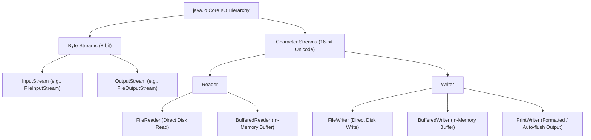
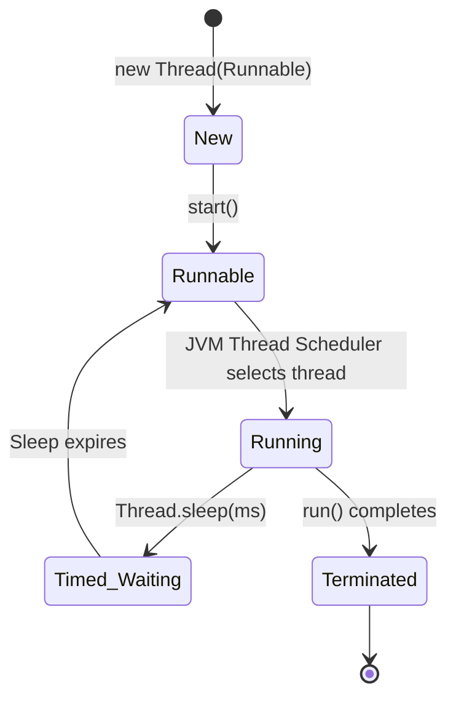
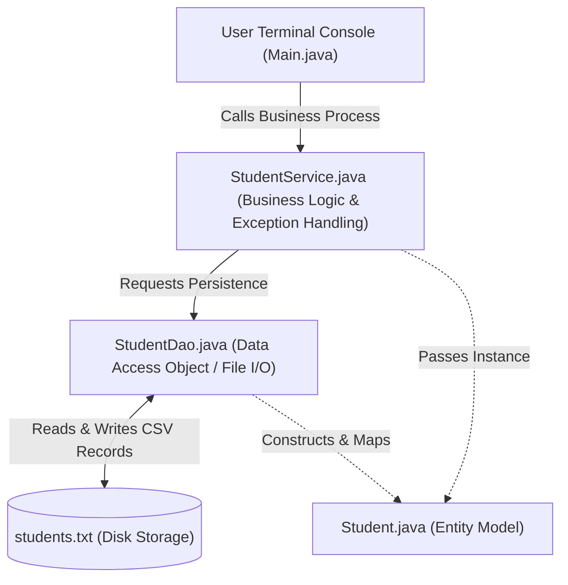

# 📅 Day 8: Java File I/O, Multithreading & Layered Architecture

<div align="center">


</div>

---

## 📖 Table of Contents
1. [🌟 Day 8 Overview](#-day-8-overview)
2. [📁 Deep Dive: Java File I/O (`java.io` Package)](#-deep-dive-java-file-io-javaio-package)
   - [Core Architecture: Character Streams vs Byte Streams](#core-architecture-character-streams-vs-byte-streams)
   - [Key Classes & Their Roles](#key-classes--their-roles)
   - [File Metadata Inspection (`FileMetadata.java`)](#file-metadata-inspection-filemetadatajava)
   - [Complete File CRUD Operations (`FileOperations.java`)](#complete-file-crud-operations-fileoperationsjava)
3. [🧵 Deep Dive: Multithreading & Concurrency](#-deep-dive-multithreading--concurrency)
   - [What is Multithreading? (Process vs. Thread)](#what-is-multithreading-process-vs-thread)
   - [Thread Lifecycle in Java](#thread-lifecycle-in-java)
   - [`Runnable` Interface vs. Extending `Thread`](#runnable-interface-vs-extending-thread)
   - [Code Implementation: `MultithreadingDemo.java`](#code-implementation-multithreadingdemojava)
   - [Execution Flow & Thread Interleaving](#execution-flow--thread-interleaving)
4. [🏗️ Enterprise Showcase: Student Management System (`Student_Project`)](#️-enterprise-showcase-student-management-system-student_project)
   - [The 3-Tier Layered Architecture Pattern](#the-3-tier-layered-architecture-pattern)
   - [Component Breakdown: Entity, DAO, Service & Controller](#component-breakdown-entity-dao-service--controller)
   - [Architectural Sequence Diagram](#architectural-sequence-diagram)
5. [📊 Summary Comparison Matrix](#-summary-comparison-matrix)
6. [🚀 Compilation & Execution Guide](#-compilation--execution-guide)

---

## 🌟 Day 8 Overview

Day 8 focused on core enterprise backend capabilities in Java:
* **File I/O & Persistence**: Mastering `java.io` to persist, retrieve, update, and inspect files on the local filesystem using buffered streams and character readers/writers.
* **Multithreading & Asynchronous Execution**: Utilizing Java's threading model with the `Runnable` interface, understanding non-blocking concurrent thread execution and `Thread.sleep()`.
* **Layered Software Architecture**: Constructing a production-style **Student Management System** leveraging the Model-DAO-Service-Controller pattern with file-based persistence.

---

## 📁 Deep Dive: Java File I/O (`java.io` Package)

### Core Architecture: Character Streams vs Byte Streams

Java organizes input and output operations into **Streams**:
1. **Byte Streams (`InputStream` / `OutputStream`)**: Process data byte-by-byte (8-bit bytes). Used for binary files like images, audio, video, and serialized objects.
2. **Character Streams (`Reader` / `Writer`)**: Process data character-by-character (16-bit Unicode). Optimized for human-readable plain text files (`.txt`, `.csv`, `.json`).



---

### Key Classes & Their Roles

| Class | Purpose | Key Advantages |
| :--- | :--- | :--- |
| **`File`** | Represents file and directory pathnames in an abstract system-independent manner. | Checks file existence, size, permissions, creates/deletes files. |
| **`FileWriter`** | Convenience class for writing character files to disk. | Simple writing of strings and chars directly to a file. |
| **`FileReader`** | Convenience class for reading character files from disk. | Reads single characters or character arrays. |
| **`BufferedWriter`** | Writes text to a character-output stream, buffering characters to provide efficient writing. | Reduces disk write operations by batching data in an internal buffer. |
| **`BufferedReader`** | Reads text from a character-input stream, buffering characters to provide efficient reading. | Provides `readLine()` for reading entire lines at a time. |
| **`PrintWriter`** | Prints formatted representations of objects to a text-output stream. | Offers `println()`, `print()`, and easy append mode without throwing checked exceptions. |

---

### File Metadata Inspection (`FileMetadata.java`)

Before manipulating files, real-world systems inspect file properties such as existence, path, readability, and size.

```java
import java.io.File;
import java.io.IOException;

public class FileMetadata {
    public static void printFileDetails(File file) {
        System.out.println("File Name:        " + file.getName());
        System.out.println("Absolute Path:    " + file.getAbsolutePath());
        System.out.println("Exists:           " + file.exists());
        System.out.println("File Size (bytes):" + file.length());
        System.out.println("Can Read:         " + file.canRead());
        System.out.println("Can Write:        " + file.canWrite());
        System.out.println("Is Normal File:   " + file.isFile());
        System.out.println("Is Directory:     " + file.isDirectory());
    }

    public static void main(String[] args) throws IOException {
        File file = new File("test.txt");
        if (!file.exists()) file.createNewFile();
        printFileDetails(file);
        file.delete();
    }
}
```

**Output:**
```text
=========================================
         FILE METADATA INSPECTION        
=========================================
File Name:        test.txt
Absolute Path:    C:\clg\UPS_Training\test.txt
Exists:           true
File Size (bytes):0
Can Read:         true
Can Write:        true
Is Normal File:   true
Is Directory:     false
=========================================
```

---

### Complete File CRUD Operations (`FileOperations.java`)

Demonstrates complete **Create, Read, Update, Delete (CRUD)** operations on text files:

```java
import java.io.*;

public class FileOperations {

    // 1. Create a new file
    public static void createFile(String fileName) throws IOException {
        File file = new File(fileName);
        if (file.createNewFile()) {
            System.out.println("File created: " + file.getName());
        } else {
            System.out.println("File already exists: " + file.getName());
        }
    }

    // 2. Write to a file using FileWriter
    public static void writeToFile(String fileName, String content) throws IOException {
        FileWriter writer = new FileWriter(fileName);
        writer.write(content);
        writer.close();
        System.out.println("Successfully wrote to " + fileName + " using FileWriter.");
    }

    // 3. Write using BufferedWriter (High performance)
    public static void writeWithBufferedWriter(String fileName, String content) throws IOException {
        FileWriter writer = new FileWriter(fileName);
        BufferedWriter bufferedWriter = new BufferedWriter(writer);
        bufferedWriter.write(content);
        bufferedWriter.newLine();
        bufferedWriter.close();
        System.out.println("Successfully wrote to " + fileName + " using BufferedWriter.");
    }

    // 4. Append to file using PrintWriter
    public static void appendToFile(String fileName, String content) throws IOException {
        PrintWriter writer = new PrintWriter(new FileWriter(fileName, true)); // 'true' enables append mode
        writer.println(content);
        writer.close();
        System.out.println("Successfully appended to " + fileName + " using PrintWriter.");
    }

    // 5. Read from file using BufferedReader (reads line by line)
    public static String readFromFile(String fileName) throws IOException {
        FileReader reader = new FileReader(fileName);
        BufferedReader bufferedReader = new BufferedReader(reader);
        String line;
        StringBuilder content = new StringBuilder();

        System.out.println("\n--- Reading Content from " + fileName + " ---");
        while ((line = bufferedReader.readLine()) != null) {
            System.out.println(line);
            content.append(line).append("\n");
        }
        bufferedReader.close();
        reader.close();
        return content.toString();
    }

    // 6. Edit file content (Find and Replace in File)
    public static void editFile(String fileName, String targetWord, String replacementWord) throws IOException {
        FileReader reader = new FileReader(fileName);
        BufferedReader bufferedReader = new BufferedReader(reader);
        String line;
        StringBuilder content = new StringBuilder();

        while ((line = bufferedReader.readLine()) != null) {
            content.append(line).append("\n");
        }
        bufferedReader.close();
        reader.close();

        // Perform replacement
        String updatedContent = content.toString().replaceAll(targetWord, replacementWord);

        FileWriter writer = new FileWriter(fileName);
        writer.write(updatedContent);
        writer.close();
        System.out.println("Successfully edited " + fileName + ": replaced '" + targetWord + "' with '" + replacementWord + "'.");
    }

    // 7. Delete a file
    public static void deleteFile(String fileName) {
        File file = new File(fileName);
        if (file.delete()) {
            System.out.println("Deleted the file: " + file.getName());
        } else {
            System.out.println("Failed to delete the file: " + file.getName());
        }
    }
}
```

---

## 🧵 Deep Dive: Multithreading & Concurrency

### What is Multithreading? (Process vs. Thread)

* **Process**: An executing instance of a program in its own isolated memory space.
* **Thread**: A lightweight sub-process; the smallest unit of dispatchable execution within a process. Threads in the same process share common heap memory, allowing efficient inter-thread communication.
* **Multithreading**: The capability of the JVM to execute multiple threads concurrently, maximizing CPU core utilization.

### Thread Lifecycle in Java



1. **New**: Thread instance created, not yet started.
2. **Runnable / Running**: `start()` called; thread is ready or actively executing instructions on a CPU core.
3. **Timed Waiting**: Paused for a specified duration via `Thread.sleep(1000)`.
4. **Terminated**: The `run()` method finishes execution.

---

### `Runnable` Interface vs. Extending `Thread`

In Java, implementing the **`Runnable` interface** is considered superior to extending `Thread`:
* **Inheritance Flexibility**: Java does not support multiple class inheritance. Implementing `Runnable` keeps the subclass free to extend other business classes.
* **Separation of Concerns**: Decouples the task logic (`run()`) from the execution mechanism (`Thread` management).
* **Thread Pooling**: `Runnable` instances can be directly submitted to `ExecutorService` and modern concurrency pools.

---

### Code Implementation: `MultithreadingDemo.java`

```java
class A implements Runnable {
    @Override
    public void run() {
        try {
            System.out.println("Thread A has started and will sleep for 1000ms...");
            Thread.sleep(1000); // Thread yields CPU and enters TIMED_WAITING
        } catch (InterruptedException e) {
            System.out.println("Thread A interrupted: " + e.getMessage());
        }
        System.out.println("Thread A is running (finished sleeping)");
    }
}

class B implements Runnable {
    @Override
    public void run() {
        System.out.println("Thread B is running immediately");
    }
}

public class MultithreadingDemo {
    public static void main(String[] args) {
        System.out.println("--- Main Thread Starting ---");

        // Instantiating Runnables wrapped in Thread instances
        Thread threadA = new Thread(new A(), "Worker-A");
        Thread threadB = new Thread(new B(), "Worker-B");

        // Triggering concurrent execution
        threadA.start();
        threadB.start();

        System.out.println("--- Main Thread Continuing Concurrent Execution ---");
    }
}
```

### Execution Flow & Thread Interleaving

```text
--- Main Thread Starting ---
--- Main Thread Continuing Concurrent Execution ---
Thread A has started and will sleep for 1000ms...
Thread B is running immediately
Thread A is running (finished sleeping)
```

**Key Observation**:
* `threadA.start()` is called first, but it immediately enters a 1-second sleep (`Thread.sleep(1000)`).
* While Thread A is sleeping, the CPU does not halt. Instead, the OS / JVM Thread Scheduler immediately switches execution to **Thread B** and the **Main Thread**, executing them without waiting.
* Once the 1000ms timer expires, Thread A wakes back up and finishes its `run()` method.

---

## 🏗️ Enterprise Showcase: Student Management System (`Student_Project`)

### The 3-Tier Layered Architecture Pattern

Rather than writing monolithic code where user input, business validation, and disk I/O are mixed together, enterprise applications divide responsibilities across clean layers:



### Component Breakdown:

1. **Entity Model (`Student.java`)**:
   - Represents the data model with private fields `id` and `name`, public constructor, and getters/setters.
2. **Data Access Object (`StudentDao.java`)**:
   - Directly interacts with `students.txt` file storage.
   - `writeStudent()`: Captures current timestamp using `java.time.LocalDateTime` and appends `id,name (Added: dd-MM-yyyy HH:mm)` records using `BufferedWriter` in append mode.
   - `readStudents()`: Reads records line by line using `BufferedReader`.
   - `deleteStudent()`: Filters out records matching `targetId` and rewrites remaining entries.
3. **Service Layer (`StudentService.java`)**:
   - Orchestrates business workflows (`addStudentProcess`, `viewAllStudents`, `removeStudentProcess`).
   - Handles `IOException` cleanly with `try-catch`, shielding upper UI layers from disk-level crashes.
4. **Console Controller (`Main.java`)**:
   - Menu-driven interactive console using `Scanner` and `switch-case`.

---

## 📊 Summary Comparison Matrix

| Feature | `FileWriter` | `BufferedWriter` | `PrintWriter` |
| :--- | :--- | :--- | :--- |
| **Buffering** | No (writes directly to disk) | Yes (internal memory buffer) | Optional / Buffered wrapper |
| **Convenience Methods** | `write()` | `write()`, `newLine()` | `print()`, `println()`, `printf()` |
| **Exception Handling** | Throws checked `IOException` | Throws checked `IOException` | Suppresses exceptions (check via `checkError()`) |
| **Primary Use Case** | Small, infrequent writes | High-throughput, bulk text writing | Formatted report & logging output |

| Concurrency Approach | Inheritance (`extends Thread`) | Composition (`implements Runnable`) |
| :--- | :--- | :--- |
| **Multiple Inheritance** | ❌ Not supported in Java | ✅ Can implement `Runnable` & extend another class |
| **Object Overhead** | Each instance is a heavyweight thread | Lightweight task decoupling |
| **ThreadPool Readiness**| Incompatible with executor tasks | Directly compatible with modern thread pools |

---

## 🚀 Compilation & Execution Guide

### 1. File Operations & Metadata
```bash
# Navigate to Day_8 directory
cd Day_8

# Compile all standalone classes
javac *.java

# Run File CRUD Operations Demo
java FileOperations

# Run File Metadata Inspection Demo
java FileMetadata

# Run Multithreading Concurrency Demo
java MultithreadingDemo
```

### 2. Student Management Project
```bash
# Compile the entire Student Project package
javac Day_8/Student_Project/*.java

# Run the Student Project interactive console
java -cp Day_8/Student_Project Main
```

---

<p align="center">
  <i>Documented and maintained with ❤️ by Ponguru Aasrith Sairam | UPS Java Full Stack Training</i>
</p>
