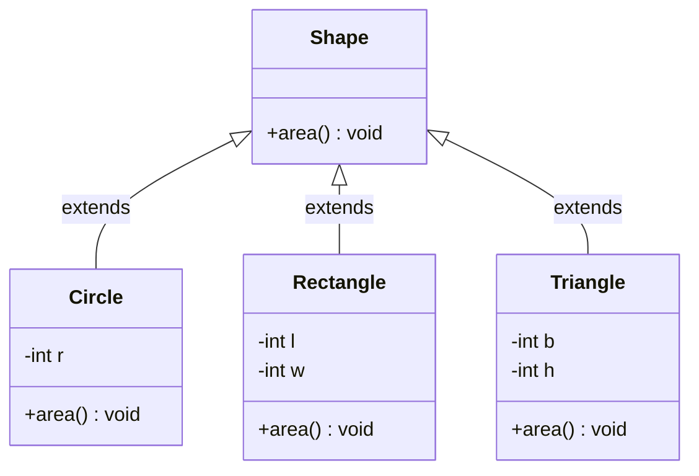

# 📅 Day 9: Friday Assessment & Core Java Technical Evaluation

<div align="center">


</div>

---

## 📖 Table of Contents
1. [🌟 Day 9 Overview](#-day-9-overview)
2. [💻 Part 1: Coding Assessment Solutions](#-part-1-coding-assessment-solutions)
   - [1. Anagram Check with Case & Space Normalization (`Anagram.java`)](#1-anagram-check-with-case--space-normalization-anagramjava)
   - [2. Custom Banking Exception Handling (`Bank.java`)](#2-custom-banking-exception-handling-bankjava)
   - [3. Bubble Sort Algorithm (`Bubble.java`)](#3-bubble-sort-algorithm-bubblejava)
   - [4. Array Duplicate Detection (`Dupli.java`)](#4-array-duplicate-detection-duplijava)
   - [5. Array Right Rotation by K Positions (`Rotate.java`)](#5-array-right-rotation-by-k-positions-rotatejava)
   - [6. Polymorphic Shape Area Hierarchy (`Shapes.java`)](#6-polymorphic-shape-area-hierarchy-shapesjava)
   - [7. Student Performance & Topper Analysis (`StudentCode.java`)](#7-student-performance--topper-analysis-studentcodejava)
   - [8. First Non-Repeating Character in String (`nonRepeating.java`)](#8-first-non-repeating-character-in-string-nonrepeatingjava)
3. [🧠 Part 2: Weekly 30 MCQs Technical Evaluation](#-part-2-weekly-30-mcqs-technical-evaluation)
   - [Overview of the 30 MCQs Test](#overview-of-the-30-mcqs-test)
   - [Core Technical Domains Tested](#core-technical-domains-tested)
4. [📊 Assessment Problem Matrix](#-assessment-problem-matrix)
5. [🚀 Compilation & Execution Guide](#-compilation--execution-guide)

---

## 🌟 Day 9 Overview

Every Friday in the **UPS Java Full Stack Training** program, we undergo a rigorous weekly evaluation designed to test both theoretical depth and practical coding proficiency under timed assessment conditions:

1. **Practical Hands-on Coding Assessment**: Implementing 8 algorithmic, object-oriented, and exception-handling problems covering strings, arrays, custom exceptions, polymorphism, and data modeling.
2. **Comprehensive 30 MCQs Technical Test**: Evaluating fundamental concepts in Core Java, JVM internals, memory allocation (Stack vs. Heap), String immutability, inheritance rules, access specifiers, and exception hierarchies.

---

## 💻 Part 1: Coding Assessment Solutions

All assessment source files are organized inside the [`Day_9/Assessment/`](./Assessment) directory.

---

### 1. Anagram Check with Case & Space Normalization (`Anagram.java`)

**Objective:** Determine if two strings are valid anagrams when ignoring character case and extraneous whitespace (e.g., `"Dormitory"` and `"Dirty room"`).

#### Key Mechanics:
* Normalizes strings by eliminating spaces using regex `replaceAll("\\s+", "")` and converting to lowercase via `toLowerCase()`.
* Converts normalized strings to character arrays, sorts them with `Arrays.sort()`, and verifies equality with `Arrays.equals()`.

File: [`Day_9/Assessment/Anagram.java`](./Assessment/Anagram.java)
```java
import java.util.Arrays;

public class Anagram {
    public static void main(String[] args) {
        String s1 = "Dormitory";
        String s2 = "Dirty room";

        String str1 = s1.replaceAll("\\s+", "").toLowerCase();
        String str2 = s2.replaceAll("\\s+", "").toLowerCase();

        boolean isAnagram = true;

        if (str1.length() != str2.length()) {
            isAnagram = false;
        } else {
            char[] arr1 = str1.toCharArray();
            char[] arr2 = str2.toCharArray();

            Arrays.sort(arr1);
            Arrays.sort(arr2);

            isAnagram = Arrays.equals(arr1, arr2);
        }

        System.out.println("String 1: \"" + s1 + "\"");
        System.out.println("String 2: \"" + s2 + "\"");
        System.out.println("Output: " + (isAnagram ? "Anagram" : "Not Anagram"));
    }
}
```

**Output:**
```text
String 1: "Dormitory"
String 2: "Dirty room"
Output: Anagram
```

---

### 2. Custom Banking Exception Handling (`Bank.java`)

**Objective:** Implement a custom checked exception `insufficientBalanceException` that triggers when an account withdrawal exceeds available balance.

#### Key Mechanics:
* Creates a subclass of `java.lang.Exception`.
* Throws the exception if `amount > balance`.
* Handles the exception gracefully using `try-catch` to avoid application termination.

File: [`Day_9/Assessment/Bank.java`](./Assessment/Bank.java)
```java
class insufficientBalanceException extends Exception {
    insufficientBalanceException(String msg) {
        super(msg);
    }
}

class BankAccount {
    int balance = 5000;

    void withdraw(int amt) throws insufficientBalanceException {
        if (amt > balance) {
            throw new insufficientBalanceException("Insufficient balance error");
        }
        balance = balance - amt;
    }
}

public class Bank {
    public static void main(String[] args) {
        BankAccount account = new BankAccount();
        System.out.println("initial balance: " + account.balance);
        try {
            account.withdraw(6000); // Exceeds balance of 5000
        } catch (insufficientBalanceException e) {
            System.out.println(e.getMessage());
        }
        System.out.println("available balance is: " + account.balance);
    }
}
```

**Output:**
```text
initial balance: 5000
Insufficient balance error
available balance is: 5000
```

---

### 3. Bubble Sort Algorithm (`Bubble.java`)

**Objective:** Sort an unsorted integer array `{35, 12, 8, 67, 21, 4}` in ascending order without utilizing built-in library sorting methods.

#### Key Mechanics:
* Iterates through adjacent elements using nested loops.
* Swaps adjacent elements if `arr[j] > arr[j + 1]`.
* Time Complexity: $O(N^2)$, Space Complexity: $O(1)$.

File: [`Day_9/Assessment/Bubble.java`](./Assessment/Bubble.java)
```java
public class Bubble {
    public static void main(String[] args) {
        int[] arr = {35, 12, 8, 67, 21, 4};

        for (int i = 0; i < arr.length; i++) {
            for (int j = 0; j < arr.length - 1; j++) {
                if (arr[j] > arr[j + 1]) {
                    int temp = arr[j];
                    arr[j] = arr[j + 1];
                    arr[j + 1] = temp;
                }
            }
        }

        System.out.print("Sorted Array: ");
        for (int i = 0; i < arr.length; i++) {
            System.out.print(arr[i] + " ");
        }
        System.out.println();
    }
}
```

**Output:**
```text
Sorted Array: 4 8 12 21 35 67 
```

---

### 4. Array Duplicate Detection (`Dupli.java`)

**Objective:** Identify duplicate elements in an integer array `{4, 2, 7, 4, 8, 2, 9, 4}` and print each duplicate value uniquely.

#### Key Mechanics:
* Compares each element with subsequent elements.
* Sets duplicate positions to a sentinel marker (`-1`) to avoid redundant duplicate reporting.

File: [`Day_9/Assessment/Dupli.java`](./Assessment/Dupli.java)
```java
public class Dupli {
    public static void main(String[] args) {
        int[] arr = {4, 2, 7, 4, 8, 2, 9, 4};
        System.out.print("Duplicate elements: ");

        for (int i = 0; i < arr.length; i++) {
            boolean isDuplicate = false;
            for (int j = i + 1; j < arr.length; j++) {
                if (arr[i] == arr[j] && arr[i] != -1) {
                    isDuplicate = true;
                    arr[j] = -1; // Mark as visited
                }
            }
            if (isDuplicate && arr[i] != -1) {
                System.out.print(arr[i] + " ");
            }
            arr[i] = -1; 
        }
        System.out.println();
    }
}
```

**Output:**
```text
Duplicate elements: 4 2 
```

---

### 5. Array Right Rotation by K Positions (`Rotate.java`)

**Objective:** Rotate an integer array `{1, 2, 3, 4, 5, 6, 7}` to the right by $k = 3$ steps.

#### Key Mechanics:
* In each step, the last element is saved in a temporary variable.
* Elements are shifted right by 1 position from back to front.
* The saved element is assigned to `arr[0]`.

File: [`Day_9/Assessment/Rotate.java`](./Assessment/Rotate.java)
```java
class Rotate {
    public static void main(String[] args) {
        int[] arr = {1, 2, 3, 4, 5, 6, 7};
        int k = 3;

        for (int s = 0; s < k; s++) {
            int endNo = arr[arr.length - 1];
            for (int i = arr.length - 1; i > 0; i--) {
                arr[i] = arr[i - 1];
            }
            arr[0] = endNo;
        }

        System.out.print("Rotated Array (k=3): ");
        for (int i = 0; i < arr.length; i++) {
            System.out.print(arr[i] + " ");
        }
        System.out.println();
    }
}
```

**Output:**
```text
Rotated Array (k=3): 5 6 7 1 2 3 4 
```

---

### 6. Polymorphic Shape Area Hierarchy (`Shapes.java`)

**Objective:** Demonstrate runtime polymorphism through an inheritance hierarchy where subclasses override the `area()` method.



File: [`Day_9/Assessment/Shapes.java`](./Assessment/Shapes.java)
```java
class Shape {
    void area() {}
}

class Circle extends Shape {
    int r;
    Circle(int r) { this.r = r; }
    void area() {
        System.out.println("Circle area:" + (3.14 * r * r));
    }
}

class Rectangle extends Shape {
    int l, w;
    Rectangle(int l, int w) { this.l = l; this.w = w; }
    void area() {
        System.out.println("Rectangle area:" + (l * w));
    }
}

class Triangle extends Shape {
    int b, h;
    Triangle(int b, int h) { this.b = b; this.h = h; }
    void area() {
        System.out.println("Triangle area:" + (0.5 * b * h));
    }
}

public class Shapes {
    public static void main(String[] args) {
        Shape[] shapes = new Shape[3];
        shapes[0] = new Circle(7);
        shapes[1] = new Rectangle(5, 4);
        shapes[2] = new Triangle(6, 8);

        for (int i = 0; i < shapes.length; i++) {
            shapes[i].area();
        }
    }
}
```

**Output:**
```text
Circle area:153.86
Rectangle area:20
Triangle area:24.0
```

---

### 7. Student Performance & Topper Analysis (`StudentCode.java`)

**Objective:** Encapsulate student details (marks across 5 subjects), calculate total, average, and letter grade, and find the class topper.

File: [`Day_9/Assessment/StudentCode.java`](./Assessment/StudentCode.java)
```java
class Student {
    String name; 
    int total;
    double avg;
    char grade;

    Student(String n, int m1, int m2, int m3, int m4, int m5) {
        name = n;
        total = m1 + m2 + m3 + m4 + m5;
        avg = total / 5.0;
        if (avg >= 90) grade = 'A';
        else if (avg >= 75) grade = 'B';
        else if (avg >= 60) grade = 'C';
        else if (avg >= 40) grade = 'D';
        else grade = 'F';
    }

    void display() {
        System.out.println("Name: " + name + " | Total: " + total + " | Average: " + avg + " | Grade: " + grade);
    }
}

public class StudentCode {
    public static void main(String[] args) {
        Student s1 = new Student("aasrith", 95, 96, 87, 98, 86);
        Student s2 = new Student("rohith", 90, 98, 96, 83, 84);
        Student s3 = new Student("senthil", 87, 81, 94, 90, 80);

        Student topper = s1;
        if (s2.total > topper.total) topper = s2;
        if (s3.total > topper.total) topper = s3;

        System.out.println("--- Student Details ---");
        s1.display();
        s2.display();
        s3.display();

        System.out.println("\n--- Class Topper ---");
        System.out.println("Topper: " + topper.name + " | Total: " + topper.total + " | Grade: " + topper.grade);
    }
}
```

**Output:**
```text
--- Student Details ---
Name: aasrith | Total: 462 | Average: 92.4 | Grade: A
Name: rohith | Total: 451 | Average: 90.2 | Grade: A
Name: senthil | Total: 432 | Average: 86.4 | Grade: B

--- Class Topper ---
Topper: aasrith | Total: 462 | Grade: A
```

---

### 8. First Non-Repeating Character in String (`nonRepeating.java`)

**Objective:** Find the first character in a string that appears exactly once (e.g., in `"swiss"`, `'s'` appears 3 times, `'w'` appears 1 time, `'i'` appears 1 time $\rightarrow$ output `'w'`).

File: [`Day_9/Assessment/nonRepeating.java`](./Assessment/nonRepeating.java)
```java
class nonRepeating {
    public static void main(String[] args) {
        String s = "swiss";

        for (int i = 0; i < s.length(); i++) {
            int count = 0;
            for (int j = 0; j < s.length(); j++) {
                if (s.charAt(i) == s.charAt(j)) {
                    count++;
                }
            }
            if (count == 1) {
                System.out.println("first non repeating char found: " + s.charAt(i));
                break;
            }
        }
    }
}
```

**Output:**
```text
first non repeating char found: w
```

---

## 🧠 Part 2: Weekly 30 MCQs Technical Evaluation

### Overview of the 30 MCQs Test
Alongside the coding assessment, we completed a **30 Multiple-Choice Questions (MCQs)** test assessing conceptual rigor across Core Java topics covered during the training.

### Core Technical Domains Tested

| Domain | Focus Areas | Key Concepts Tested |
| :--- | :--- | :--- |
| **1. OOP Principles** | Inheritance, Polymorphism, Abstraction, Encapsulation | Runtime vs. Compile-time polymorphism, dynamic method dispatch, abstract classes vs interfaces, access modifier scopes (`private`, default, `protected`, `public`). |
| **2. Exception Handling** | `try`, `catch`, `finally`, `throw`, `throws` | Checked vs. Unchecked exceptions, exception propagation, rules for creating custom exceptions extending `Exception` vs `RuntimeException`. |
| **3. Memory Management** | Stack vs. Heap Allocation | Primitive storage, object reference variables on Stack vs instances on Heap, garbage collection triggers. |
| **4. Strings in Java** | Immutability & String Constant Pool | Differences between `String`, `StringBuilder`, and `StringBuffer`, `==` vs `.equals()`, SCP memory allocation. |
| **5. Arrays & Jagged Arrays** | 1D, 2D, and Jagged arrays | Array initialization, default zero values, `.length` attribute vs `.length()` method, contiguous row references. |
| **6. Multithreading Basics** | Concurrency, Thread lifecycle | `Runnable` vs `Thread`, `Thread.sleep()`, thread states (`NEW`, `RUNNABLE`, `TIMED_WAITING`, `TERMINATED`). |

---

## 📊 Assessment Problem Matrix

| Problem | File | Paradigm / Topic | Complexity |
| :--- | :--- | :--- | :--- |
| **Anagram Check** | [`Anagram.java`](./Assessment/Anagram.java) | Strings / Sorting / Normalization | $O(N \log N)$ |
| **Custom Exception** | [`Bank.java`](./Assessment/Bank.java) | OOP / Exception Handling | $O(1)$ |
| **Bubble Sort** | [`Bubble.java`](./Assessment/Bubble.java) | Arrays / Sorting Algorithms | $O(N^2)$ |
| **Duplicate Elements** | [`Dupli.java`](./Assessment/Dupli.java) | Arrays / In-Place Frequency Marking | $O(N^2)$ |
| **Array Rotation** | [`Rotate.java`](./Assessment/Rotate.java) | Arrays / Cyclic Shifting | $O(k \cdot N)$ |
| **Shape Areas** | [`Shapes.java`](./Assessment/Shapes.java) | OOP Polymorphism / Method Overriding | $O(N)$ |
| **Student Performance** | [`StudentCode.java`](./Assessment/StudentCode.java) | OOP Modeling / Aggregation | $O(N)$ |
| **First Unique Char** | [`nonRepeating.java`](./Assessment/nonRepeating.java) | Strings / Search & Traversal | $O(N^2)$ |

---

## 🚀 Compilation & Execution Guide

To compile and run all Day 9 assessment programs:

```bash
# Navigate to the Assessment directory
cd Day_9/Assessment

# 1. Compile all assessment programs
javac *.java

# 2. Run Anagram Program
java Anagram

# 3. Run Banking Custom Exception Program
java Bank

# 4. Run Bubble Sort Program
java Bubble

# 5. Run Duplicate Elements Program
java Dupli

# 6. Run Array Rotation Program
java Rotate

# 7. Run Shapes Polymorphism Program
java Shapes

# 8. Run Student Performance Program
java StudentCode

# 9. Run First Non-Repeating Character Program
java nonRepeating
```

---

<p align="center">
  <i>Documented and maintained with ❤️ by Ponguru Aasrith Sairam | UPS Java Full Stack Training</i>
</p>
